# Enterprise IT Help Desk & Active Directory Support Lab

## Project Overview

This project demonstrates hands-on enterprise IT support skills through a simulated help desk environment built using Windows Server, Windows 11, Active Directory Domain Services (AD DS), Ubuntu Server, and GLPI IT Service Management (ITSM).

The lab was designed to replicate common technical support responsibilities, including user account administration, authentication troubleshooting, network connectivity diagnostics, file-sharing permissions, incident documentation, and ticket resolution.

Six realistic IT support incidents were simulated, investigated, resolved, and documented through the GLPI ticketing system.

### Project Objectives

- Deploy and manage a Windows Active Directory domain.
- Configure domain-joined Windows workstations.
- Install and operate a GLPI help desk ticketing system.
- Troubleshoot account lockouts, password changes, and disabled accounts.
- Diagnose DNS resolution and IPv4 connectivity issues.
- Configure SMB network shares and troubleshoot NTFS permissions.
- Document technical findings, corrective actions, and resolutions in GLPI.
- Demonstrate structured troubleshooting and incident management workflows.

> **Lab Disclaimer:** All incidents were simulated in an isolated VirtualBox environment for educational and portfolio purposes. No production systems or real employee accounts were affected.


---

## Lab Environment & Architecture

The enterprise help desk environment was deployed using Oracle VirtualBox and consisted of three virtual machines connected through an isolated internal network.

### Virtual Machines

| Machine | Operating System | Role | IPv4 Address |
|---|---|---|---|
| DC01 | Windows Server 2025 | Active Directory Domain Controller, DNS Server, SMB File Server | 192.168.20.10 |
| WS01 | Windows 11 | Domain-Joined Employee Workstation | 192.168.20.20 |
| GLPI-Server | Ubuntu Server 24.04 | GLPI ITSM Web Server | 192.168.20.30 |

### Network Configuration

- **Active Directory Domain:** `RaeTech.local`
- **Network:** `192.168.20.0/24`
- **Virtualization Platform:** Oracle VirtualBox
- **Network Type:** Internal Network (`RaeTech-Lab`)
- **Domain DNS Server:** `192.168.20.10`
- **Workstation Addressing:** Static IPv4
- **Default Gateway:** Not configured (isolated lab)

### Technologies Used

- Windows Server 2025
- Windows 11
- Active Directory Domain Services (AD DS)
- Group Policy
- Windows DNS Server
- PowerShell and Windows networking utilities
- SMB File Sharing and NTFS Permissions
- Ubuntu Server 24.04
- Apache, MariaDB, and PHP
- GLPI IT Service Management
- Oracle VirtualBox

### Environment Overview

DC01 provided centralized identity management, DNS, and file-sharing services for the RaeTech.local domain.

WS01 functioned as the employee workstation used to reproduce, investigate, and verify common IT support incidents.

The Ubuntu-based GLPI server hosted the help desk ticketing platform, allowing incidents to be assigned, documented, resolved, and closed.

All systems operated within an isolated virtual network to support controlled troubleshooting simulations.

---

## Help Desk Incident Simulations

Six IT support incidents were simulated and resolved in the RaeTech.local environment. Each scenario followed a structured troubleshooting workflow involving incident identification, technical investigation, root cause analysis, corrective action, verification, and GLPI documentation.

### Incident Summary

| Ticket | Incident | Root Cause | Resolution | Status |
|---|---|---|---|---|
| #1 | Active Directory Account Lockout | Locked AD user account | Unlocked account and verified authentication | Closed |
| #2 | Password Reset / Change Required | AD password change requirement | Reset password and verified successful sign-in | Closed |
| #3 | Disabled Active Directory Account | User account disabled in AD | Re-enabled account in the controlled lab and verified sign-in | Closed |
| #4 | DNS Resolution Failure | Incorrect preferred DNS server | Restored correct DNS configuration and verified hostname resolution | Closed |
| #5 | Internal Network Connectivity Failure | Incorrect static IPv4 address | Restored the correct IP configuration and verified connectivity | Closed |
| #6 | Finance Share Access Denied | Insufficient NTFS write permissions | Granted Finance-Staff Modify access and verified file creation | Closed |

### Standard Troubleshooting Workflow

1. Identify and document the reported issue.
2. Reproduce the problem within the lab environment.
3. Collect diagnostic information using administrative tools.
4. Identify the underlying root cause.
5. Implement the appropriate corrective action.
6. Verify that the reported functionality has been restored.
7. Document troubleshooting findings and resolution in GLPI.
8. Administratively close the simulated incident.

Each ticket includes supporting screenshots demonstrating technical findings, remediation, verification, and ticket closure.


---

## Ticket #1 — Active Directory Account Lockout

### Incident Description
A simulated account lockout prevented Marcus Reed (`RAETECH\mreed`) from successfully authenticating to the RaeTech.local domain.

### Investigation
- Investigated the affected user account in Active Directory Users and Computers (ADUC).
- Verified that the account was locked.
- Identified the account lockout as the cause of the authentication failure.

### Corrective Action
- Unlocked the affected account through Active Directory.
- Retested authentication using the affected domain account.
- Confirmed that the user could successfully sign in.

### Resolution
Domain authentication was restored. Troubleshooting findings and the resolution were documented in GLPI, and Ticket #1 was closed.

### Evidence

**Successful Domain Authentication**

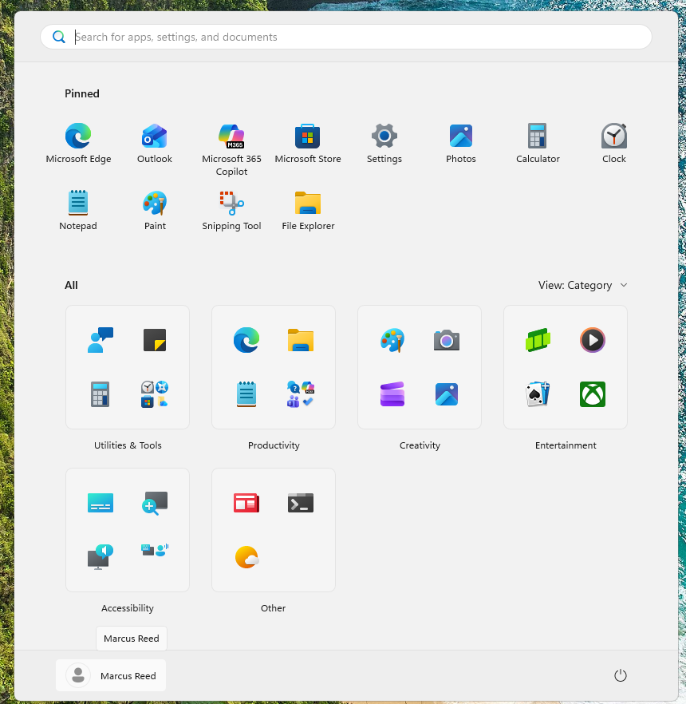

**GLPI Troubleshooting Documentation**

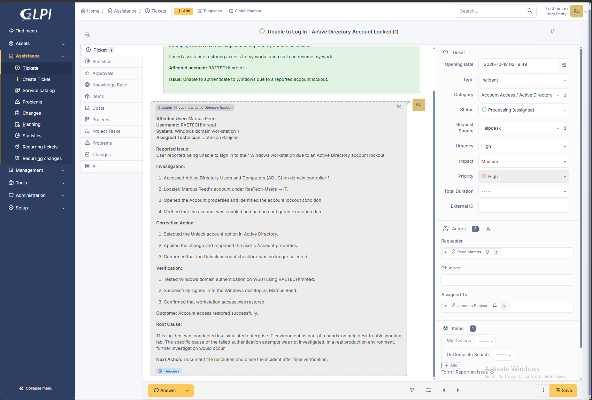

**GLPI Solution**

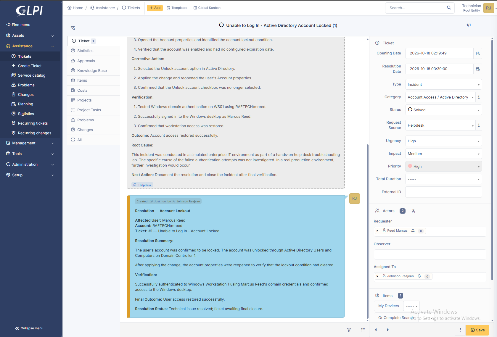

**Closed Incident**

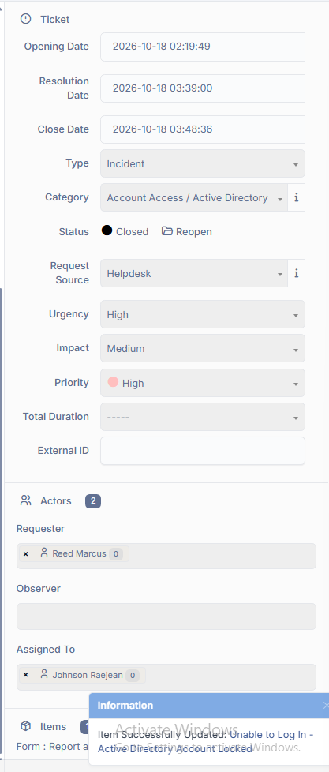


---

## Ticket #2 — Active Directory Password Reset

### Incident Description
Jordan Brooks (`RAETECH\jbrooks`), a Finance department employee, was required to change his Active Directory password before accessing his Windows workstation.

### Investigation
- Located Jordan Brooks' account in Active Directory Users and Computers (ADUC).
- Verified that the account was configured to require a password change at the next logon.
- Reproduced the Windows password-change prompt on WS01.
- Identified the password-change requirement as the cause of the interrupted sign-in.

### Corrective Action
- Reset the user's password through Active Directory.
- Required the user to change the temporary password at the next sign-in.
- Completed the password change during the simulated user login.

### Verification
- Successfully signed into WS01 using Jordan Brooks' domain account.
- Verified the authenticated identity using `whoami`.
- Confirmed that domain authentication was restored.

### Resolution
The password change requirement was completed successfully, restoring access to the domain workstation. The investigation and resolution were documented in GLPI, and Ticket #2 was closed.


### Evidence

**Password Change Required**

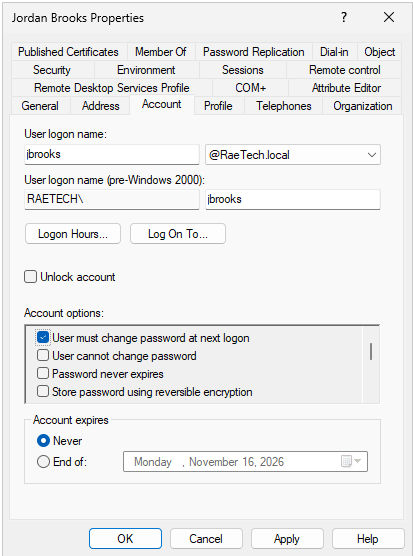

**Successful Password Reset**

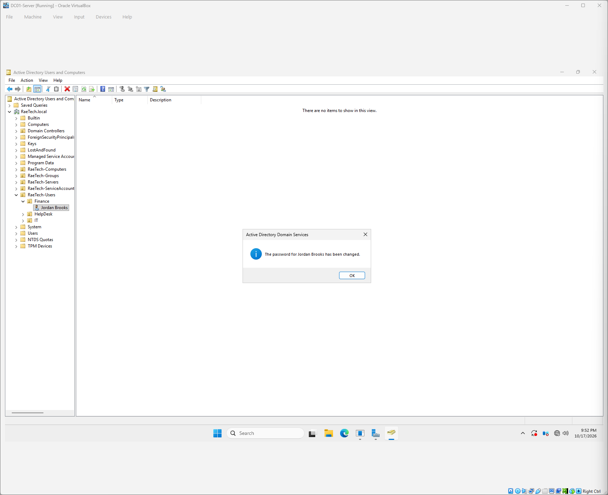

**GLPI Solution and Resolution**

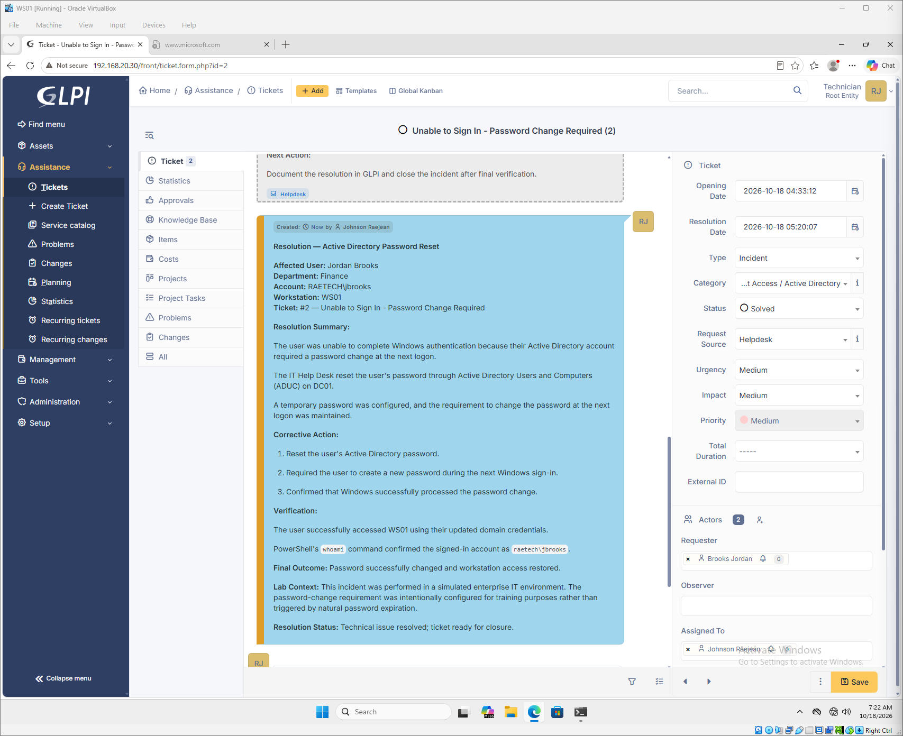

**Closed Incident**

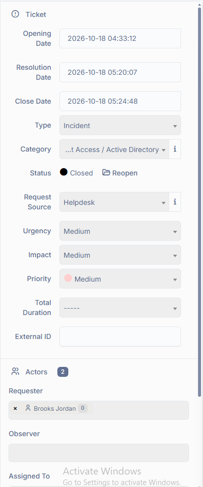


---

## Ticket #3 — Disabled Active Directory Account

### Incident Description

Marcus Reed (`RAETECH\mreed`) was unable to sign in to his Windows workstation because his Active Directory account had been disabled.

This incident was simulated to demonstrate how IT Support Technicians investigate and resolve account-access issues involving disabled domain accounts.

### Investigation

- Located Marcus Reed's account in Active Directory Users and Computers (ADUC).
- Verified that the user account was disabled.
- Attempted to authenticate to WS01 using the affected domain account.
- Reproduced the Windows error indicating that the account had been disabled.
- Identified the disabled account status as the cause of the authentication failure.

### Corrective Action

- Simulated administrator authorization to restore account access in the controlled lab.
- Re-enabled Marcus Reed's Active Directory account using ADUC.
- Verified that the account was enabled.
- Retested authentication from WS01.

### Verification

- Successfully signed in to WS01 using Marcus Reed's domain credentials.
- Confirmed the authenticated account using `whoami`.
- Verified that the Windows account-disabled error no longer prevented sign-in.

### Resolution

The simulated account-access issue was resolved by re-enabling the affected Active Directory account. The investigation, corrective action, and successful verification were documented in GLPI, and Ticket #3 was closed.

### Evidence

**Disabled Active Directory Account**

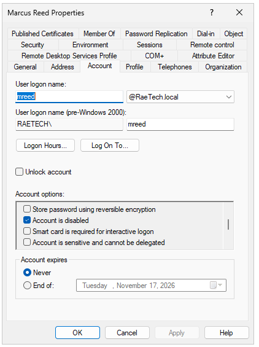

**Windows Account Disabled Error**

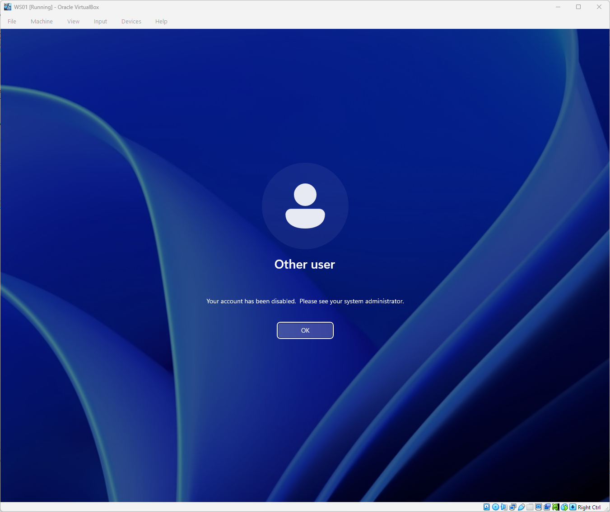

**GLPI Solution and Resolution**

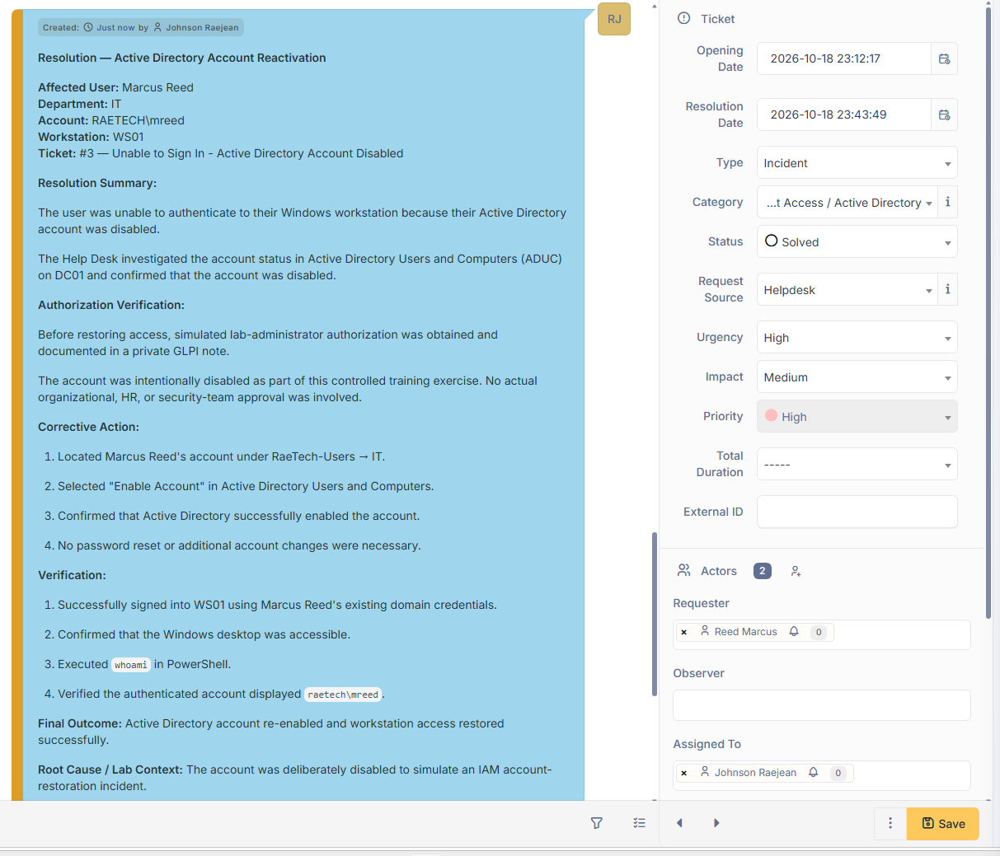

**Closed Incident**

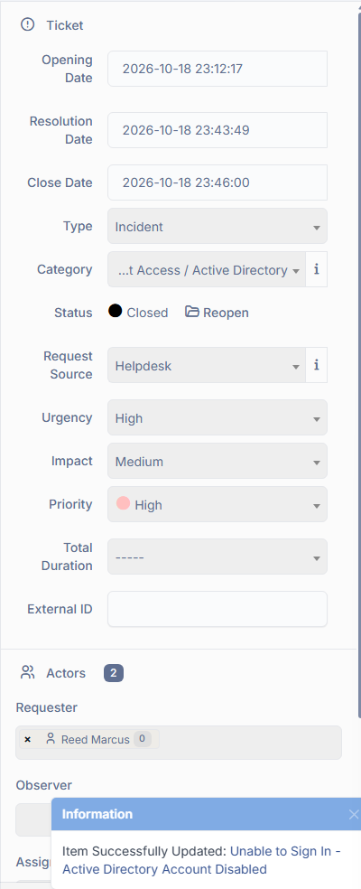


---

## Ticket #4 — DNS Resolution Failure

### Incident Description

Marcus Reed (`RAETECH\mreed`) experienced an internal hostname resolution issue on workstation WS01. The workstation could communicate with the domain controller using its IP address but could not successfully resolve its hostname.

This incident simulated a workstation configured with an incorrect DNS server.

### Investigation

- Verified WS01's IPv4 configuration using `ipconfig /all`.
- Confirmed IP connectivity to DC01 (`192.168.20.10`) using `ping`.
- Identified an incorrect preferred DNS server address of `192.168.20.254`.
- Executed `nslookup DC01.RaeTech.local` and observed DNS query failures.
- Determined that incorrect workstation DNS configuration caused the hostname resolution issue.

### Corrective Action

- Opened the Ethernet adapter's IPv4 configuration.
- Changed the preferred DNS server from `192.168.20.254` to `192.168.20.10`.
- Preserved the existing workstation IP address and subnet mask.
- Verified that the updated DNS configuration was applied.

### Verification

- Confirmed WS01 was configured to use `192.168.20.10` as its preferred DNS server.
- Executed `nslookup DC01.RaeTech.local`.
- Successfully resolved the domain controller hostname to `192.168.20.10`.
- Observed an initial timeout and "Server: UnKnown" warning that had also occurred before the simulated failure; forward hostname resolution nevertheless succeeded.

### Resolution

The simulated DNS configuration issue was resolved by restoring the correct internal DNS server address. Troubleshooting findings and corrective actions were documented in GLPI, and Ticket #4 was closed.

### Evidence

**DNS Resolution Failure**

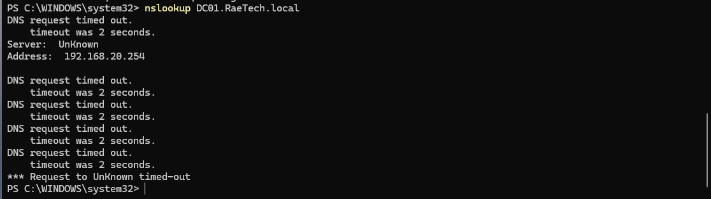

**DNS Resolution Restored**

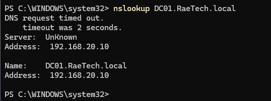

**GLPI Solution**

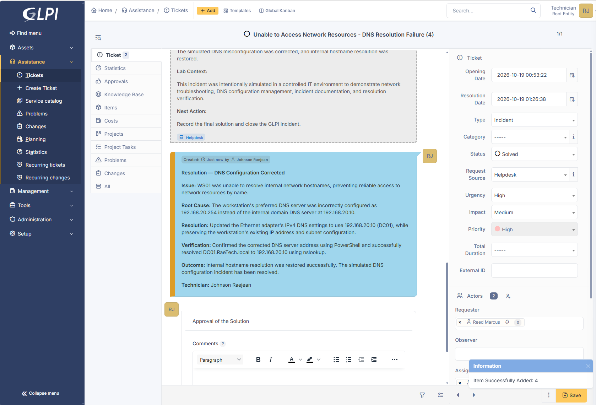

**Closed Incident**

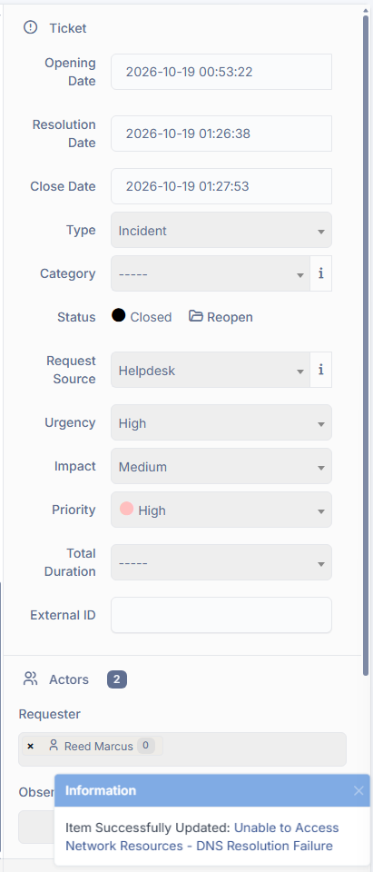


---

## Ticket #5 — Incorrect IPv4 Configuration

### Incident Description

Jordan Brooks (`RAETECH\jbrooks`) experienced a simulated network connectivity failure on workstation WS01, preventing communication with internal company resources.

The incident was reproduced by configuring the workstation with an IPv4 address outside the expected subnet.

### Investigation

- Established baseline connectivity between WS01 and DC01 using `ping 192.168.20.10`.
- Confirmed that all four ICMP requests succeeded before the simulated failure.
- Changed WS01's static IPv4 address from `192.168.20.20` to `192.168.30.20`.
- Repeated the connectivity test and observed four failed transmissions with 100% packet loss.
- Executed `ipconfig` to inspect the workstation's addressing configuration.
- Identified the incorrect IPv4 subnet as the cause of the connectivity failure.

### Root Cause

WS01 was configured on the `192.168.30.0/24` subnet, while DC01 and other internal resources were located on `192.168.20.0/24`.

Because the isolated lab workstation had no default gateway, it had no route to the domain controller.

### Corrective Action

- Opened the Ethernet adapter's IPv4 properties.
- Restored the workstation IP address to `192.168.20.20`.
- Preserved the subnet mask `255.255.255.0` and internal DNS server `192.168.20.10`.
- Left the default gateway blank, consistent with the isolated lab design.

### Verification

- Executed `ping 192.168.20.10` after restoring the correct IPv4 configuration.
- Received four successful replies with 0% packet loss.
- Confirmed network connectivity between WS01 and DC01 was restored.

### Resolution

The simulated connectivity failure was resolved by correcting WS01's static IPv4 address. The incident and completed troubleshooting were documented retrospectively in GLPI, and Ticket #5 was closed.

### Evidence

**Network Connectivity Failure**

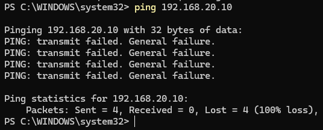

**Incorrect IPv4 Configuration**

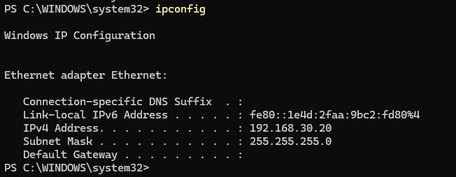

**Network Connectivity Restored**

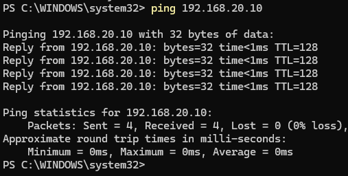

**Closed GLPI Incident**

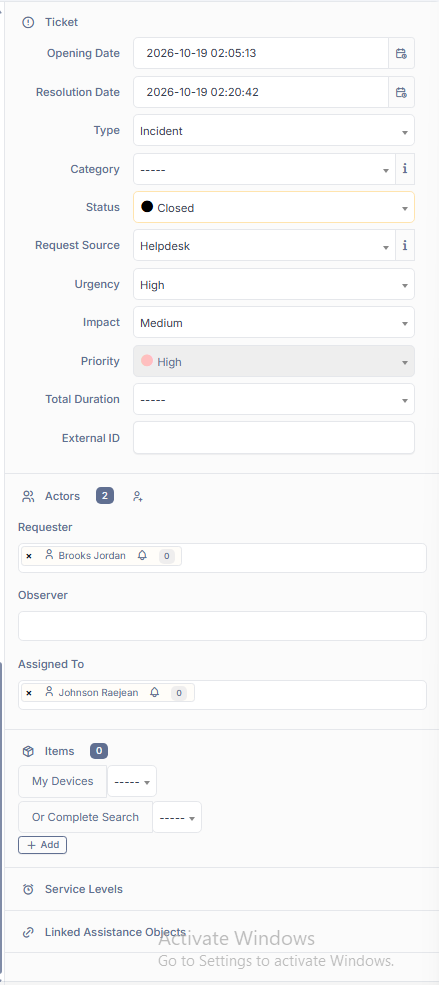


---

## Ticket #6 — Finance Shared Folder Access Denied

### Incident Description

Jordan Brooks (`RAETECH\jbrooks`), a Finance department employee, experienced a simulated permissions issue that prevented him from creating or saving files to the department's shared network folder (`\\DC01\Finance`).

Although the user could authenticate and open the shared folder, Windows displayed a "Destination Folder Access Denied" error when attempting to create new files.

### Investigation

- Created a dedicated Finance share on DC01 using SMB.
- Verified that Jordan Brooks was a member of the `Finance-Staff` Active Directory security group.
- Confirmed that the Finance-Staff group had Change permissions at the SMB sharing level.
- Established a successful file creation baseline before simulating the permission issue.
- Backed up the existing NTFS permissions using `icacls`.
- Configured the Finance folder with Read & Execute NTFS permissions for Finance-Staff.
- Reproduced an Access Denied error when attempting to create a new file from WS01.

### Root Cause

The Finance-Staff security group had Change permissions through SMB but only Read & Execute permissions through NTFS.

Because both permission layers must allow an operation, the restrictive NTFS permissions prevented the user from creating files despite sufficient SMB share permissions.

### Corrective Action

Updated the NTFS permissions on `C:\FinanceShare` to grant the Finance-Staff security group Modify access.

The following PowerShell command was used on DC01:

```powershell
icacls "C:\FinanceShare" /grant "RAETECH\Finance-Staff:(OI)(CI)M"
```

Administrator and SYSTEM Full Control permissions were preserved. General BUILTIN\Users permissions remained removed.

### Verification

- Accessed `\\DC01\Finance` from WS01 using Jordan Brooks' domain credentials.
- Successfully created `Finance-Permissions-Restored.txt`.
- Confirmed that the Access Denied error no longer occurred during file creation.
- Verified that Finance-Staff had Modify permissions through NTFS.

### Resolution

The simulated file-sharing incident was resolved by correcting the NTFS permissions assigned to the Finance-Staff security group.

The technical investigation and solution were documented retrospectively in GLPI, and Ticket #6 was administratively closed.

### Evidence

**Finance Share Access Denied**

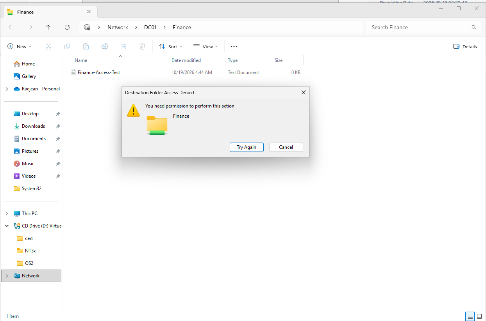

**File Creation Successfully Restored**

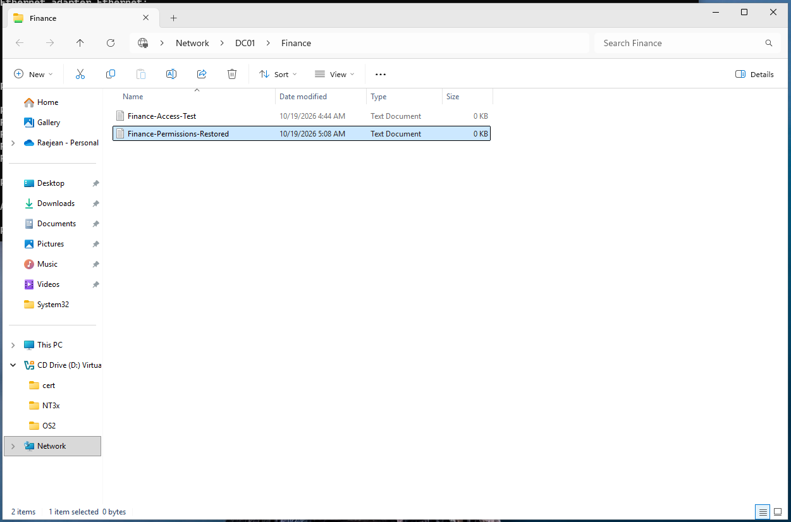

**GLPI Solution and Resolution**

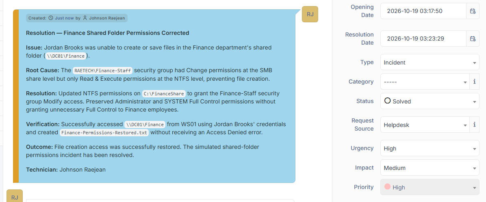

**Closed Incident**

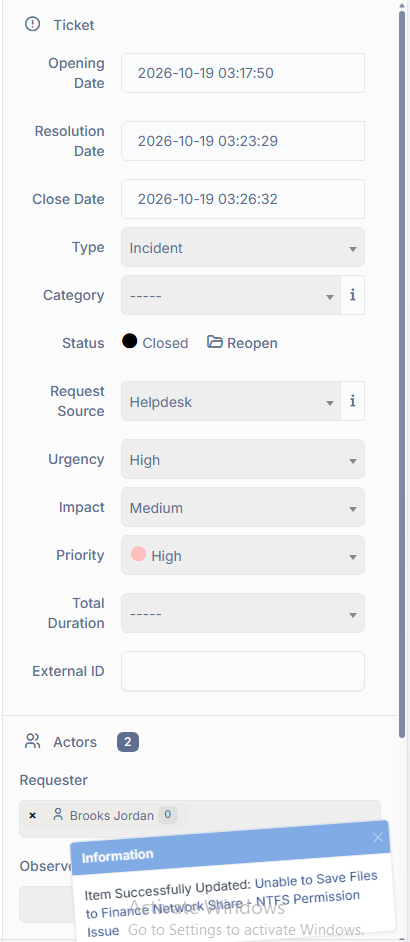


---

## Technical Skills Demonstrated

### Active Directory Administration
- Managed domain user accounts using Active Directory Users and Computers (ADUC).
- Troubleshot locked and disabled domain accounts.
- Performed password resets and enforced password changes.
- Verified Active Directory security group membership.
- Tested domain authentication on a Windows 11 workstation.

### Windows & Network Troubleshooting
- Diagnosed network connectivity failures using `ping` and `ipconfig`.
- Investigated DNS resolution issues using `nslookup`.
- Configured static IPv4 addresses and internal DNS settings.
- Identified incorrect subnet configurations and restored connectivity.
- Verified technical resolutions through before-and-after testing.

### File Sharing & Access Control
- Configured SMB network shares on Windows Server.
- Managed folder access through Active Directory security groups.
- Investigated the relationship between SMB share permissions and NTFS permissions.
- Used `icacls` to inspect and modify NTFS access control entries.
- Applied least-privilege access using Modify permissions rather than unnecessary Full Control.

### IT Service Management
- Deployed and operated GLPI in an Ubuntu Server environment.
- Created, assigned, and managed simulated help desk incidents.
- Documented technical investigations through internal technician notes.
- Recorded root causes, corrective actions, and verification results.
- Submitted incident solutions and completed administrative ticket closure.

## Project Outcomes

Successfully completed six simulated enterprise IT help desk incidents covering Active Directory administration, authentication, DNS, IPv4 networking, and file-sharing permissions.

Each incident included technical troubleshooting, corrective action, verification, and GLPI documentation.

The project demonstrates practical familiarity with common IT Support and Help Desk responsibilities, structured troubleshooting, Windows Server administration, and incident management workflows.

## Future Improvements

- Implement a dedicated Windows file server separate from the domain controller.
- Expand GLPI ticket categories and service-level management.
- Introduce additional Group Policy troubleshooting scenarios.
- Configure centralized event collection for workstation and server diagnostics.
- Explore automation of repetitive support tasks using PowerShell.

---

**Project Type:** Independent Hands-On IT Support Lab

**Environment:** Simulated Enterprise Network

**Platforms:** Windows Server, Windows 11, Ubuntu Server, Active Directory, GLPI, Oracle VirtualBox

